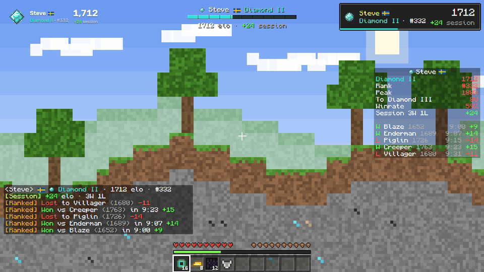
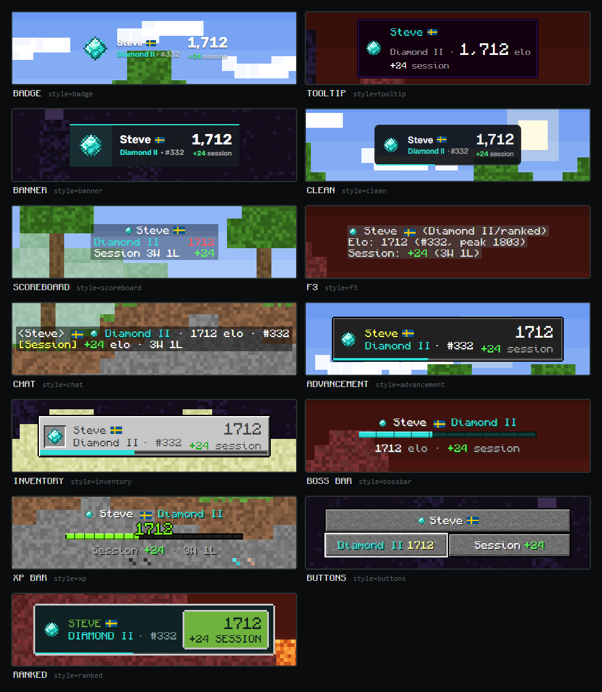
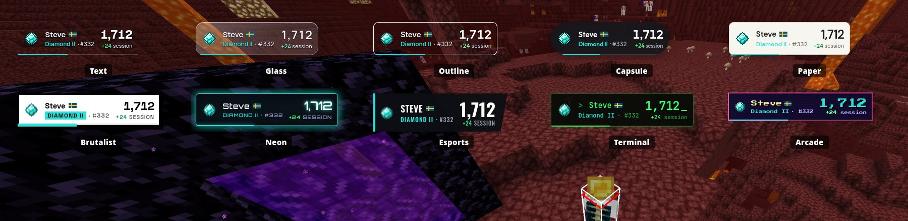
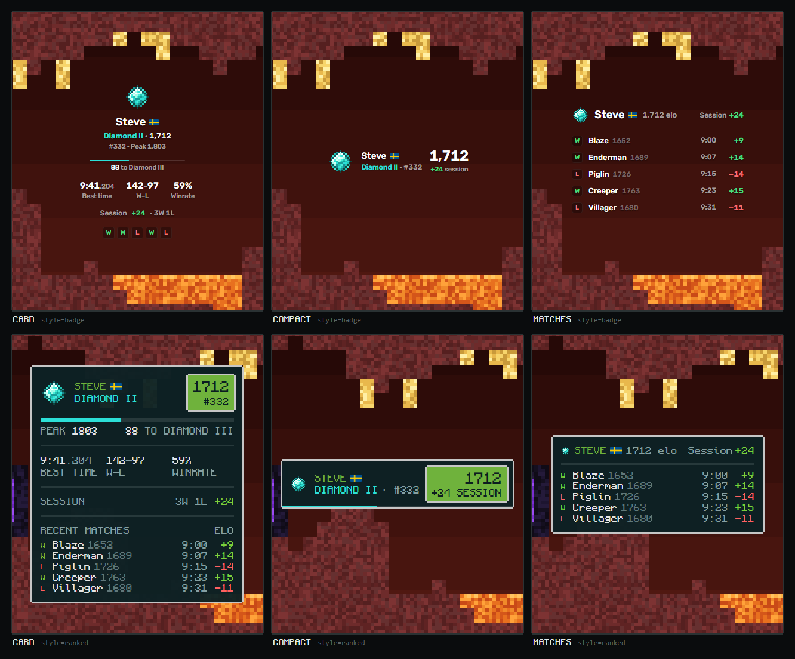
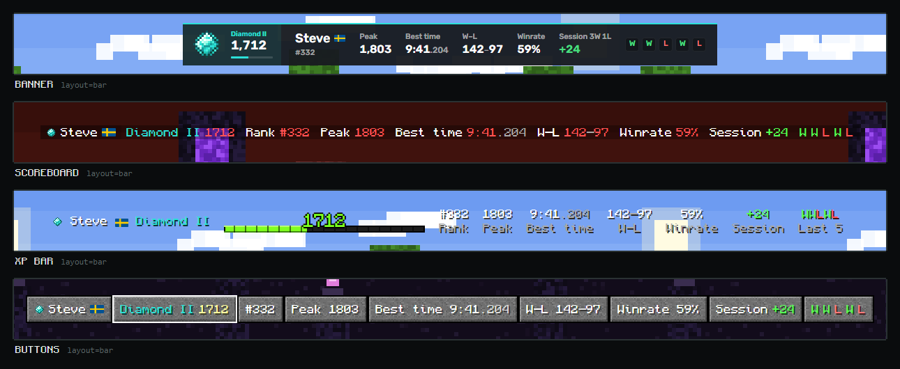
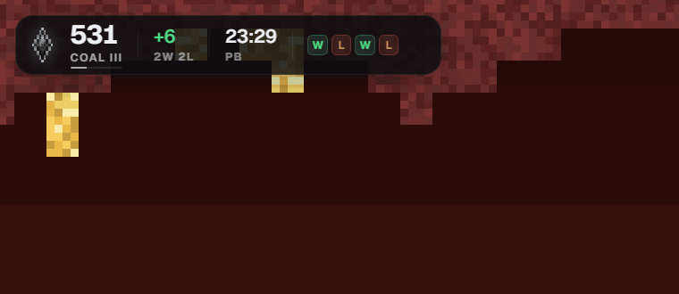
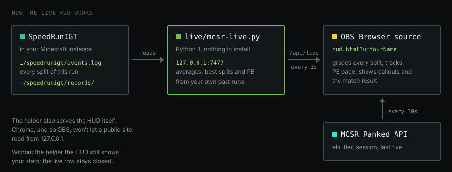

# mcsr-overlay

OBS overlays for [MCSR Ranked](https://mcsrranked.com): rank badge, elo, tier progress, session, PB and recent matches for any player, in 23 styles. There's also a live HUD that grades your splits while you play.

Set it up in the [customizer](https://orqz.github.io/mcsr-overlay/) and paste the URL into an OBS browser source, or [try a demo](https://orqz.github.io/mcsr-overlay/overlay.html?demo=1&style=scoreboard).

Fully vibe coded with [Claude Code](https://claude.com/claude-code).

<p align="center"></p>

## Styles

Twenty-three styles, and every one works in all four layouts. Four are broadcast graphics, nine are built from Minecraft's own screens (in Minecraft's colors, font and text shadow), eight are modern looks with nothing Minecraft about them, and two are retro screens. Every style can also show [the run you're in](#live-run-in-every-style), and every one can be restyled with the [options](#options).

<p align="center"></p>
<p align="center"></p>

| Style | Looks like |
| --- | --- |
| `badge` (default) | The rank badge up front, no box, text shadow so it reads over gameplay |
| `tooltip` | A Minecraft item tooltip |
| `banner` | Broadcast graphics with tier-colored rules |
| `clean` | A minimal flat panel |
| `scoreboard` | The sidebar: your name on top, red scores down the right |
| `f3` | The debug screen, a gray box behind every line. It lines up on the right when the overlay does |
| `chat` | Chat messages, newest at the bottom: `[Ranked] Won vs … in 9:23 +15` |
| `advancement` | The advancement toast. Netherite gets the purple challenge title |
| `inventory` | The light gray container GUI, your badge in a slot and stats in sunken slots |
| `bossbar` | Your name over a notched boss bar that fills with tier progress |
| `xp` | Your elo as the green XP level over the experience bar |
| `buttons` | The game menu: a stone button per line, the elo one hovered, tier progress as a slider |
| `ranked` | After MCSR Ranked's logo: a dark panel in a light pixel frame, green name, green elo box |
| `text` | Just text with a shadow: no panel, no lines |
| `glass` | A frosted pane with a light edge |
| `outline` | See-through, with thin lines around the panel and each stat |
| `capsule` | Everything rounded into pills |
| `paper` | A light card with a soft shadow, for bright scenes |
| `brutal` | Black and white, thick lines, a hard offset shadow, your tier on a colored tag |
| `neon` | A dark panel with a lit edge and glowing elo in your tier color |
| `esports` | A broadcast lower third: cut corner, big condensed numbers, an accent stripe |
| `terminal` | A console: `>` prompt, `#` labels and a blinking cursor after your elo |
| `arcade` | A cabinet screen: pixel type, scanlines, a pink frame |

## Layouts

`card` has everything, `compact` is just elo and session, `matches` is your recent results, and `bar` puts it all on one line for the top or bottom of the screen.

<p align="center"></p>
<p align="center"></p>

## The customizer

[orqz.github.io/mcsr-overlay](https://orqz.github.io/mcsr-overlay/) builds the URL. The preview is a 1920×1080 game scene (overworld, nether, end, or a flat color for chroma key), so you see the overlay at its real size next to the hotbar. The style picker shows every style with your own profile. **+ Win** and **+ Loss** fake a match so you can see the popup and the session update. **Import URL** loads the URL from an existing OBS source back in, and so does opening `index.html?u=…&style=…`. Ctrl+Z undoes, Ctrl+Shift+Z redoes. Without a username it shows a demo player.

## Live HUD

<p align="center"></p>

`hud.html` is one small pill: rank badge, elo, tier progress, session elo, PB and your last five results. While you're in a run, a second row opens under it and reacts to every split, comparing it with your own past runs:

- Each split (nether, bastion, fortress, blind, stronghold, end, finish) gets a verdict: best ever, great, good, okay or slow pace, plus how far ahead of or behind your average you are.
- The track has a dot per split, and the gap to the next dot fills toward your average time for it. It turns orange once you're past that average.
- PB pace: while you're ahead of your PB run's splits, a gold light runs around the edge and the PB slot shows how far ahead you are. It switches off as soon as the clock passes your PB run's next split.
- Callouts under the pill: the opponent when a match starts, each split, a new PB, then the match result with your elo counting up.

<p align="center"></p>

The live part needs a small helper that reads the files [SpeedRunIGT](https://github.com/RedLime/SpeedRunIGT) writes: the current world's `events.log`, and `~/speedrunigt/records/` for your averages, best splits and PB. Ranked worlds are compared with ranked worlds, RSG with RSG. The helper also serves the HUD, because Chrome (and so OBS) blocks a public site from reading `127.0.0.1`.

1. [Download this repo](https://github.com/orqz/mcsr-overlay/archive/refs/heads/main.zip) (or clone it) and start the helper from its folder. Python 3, nothing to install:

   ```bash
   python3 live/mcsr-live.py
   ```

   On Windows that's `py live\mcsr-live.py`. It prints `mcsr-live on http://127.0.0.1:7477/hud.html?u=<your name>`. On Linux, `live/mcsr-live.service` starts it on login.

2. In OBS, add a **Browser** source:

   ```
   http://127.0.0.1:7477/hud.html?u=YourName&scale=1.4
   ```

3. Size it to 640×260 and leave the source's transform at 100% so the text stays sharp. Use `scale` to resize it instead.

Other params: `bga` sets panel opacity (0–100, default 84), `live=0` shows stats only, and `demo` plays a fake run so you can see every animation (`demo=40` is faster). Without the helper, the HUD still shows your stats. `python3 live/mcsr-live.py --dump` prints what the helper sees right now.

### Live run in every style

The overlay's 23 styles show the same live run as the HUD, each in its own way: a row with the track in the panel styles, a line per split in Scoreboard, `Run:` lines in F3, a `[Run]` message per split in Chat, a second boss bar that fills toward your next split in Boss bar, and a slider in Buttons. Each split also gets a popup, and PB pace lights up gold (a light around the panel, or the frame in the framed Minecraft styles).

Turn on **Live run** in the customizer. The URL it gives you points at the helper, `http://127.0.0.1:7477/overlay.html?u=YourName&style=…&run=1`, for the same reason as the HUD: OBS won't let a page on github.io read `127.0.0.1`. The size it shows leaves room for the run, so the source doesn't need resizing mid-run. Both the HUD and the overlay grade splits with `live.js`, so they always agree.

## Text widgets

A plainer look: white text with a dark shadow, no panels, nothing else on screen. Both pages are served by the helper, like the HUD.

- `stats.html?u=YourName`: your skin's face and name, then elo and rank, then your PB and how today is going (`pb 23:29 · +23 today (4–1)`). Browser source 1000×220 with `scale=1.8` on a 1440p canvas (`scale=1.35` on 1080p).
- `timer.html`: the run clock in whole seconds, no milliseconds, hidden between runs. It goes gold while you're on PB pace and green when you finish, and the line under it is your pace against your PB:
  - before your first split: `pb nether 3:28`, what you're chasing
  - after a split: `nether 2:29 −0:59`, green when you're ahead, red when behind
  - once you pass the time your PB hit its next split: a red `+0:12` that counts up

  `clock=0` shows only the pace line, for when the stream shows the in-game timer instead (below). Browser source 600×176, or 600×80 with `clock=0`. `align=left` lines it up on the left.
- `hud.html?…&theme=plain` gives the HUD the same look.

Splits are compared in route order (nether, bastion, fortress, blind, stronghold, end). A PB split that was logged out of order is skipped: SpeedRunIGT only logs the first time you enter a fortress, so clipping one on the way to a bastion leaves no real fortress time. In a Ranked match the clock starts when the countdown ends; the helper reads that from the game's `logs/latest.log` until your first split pins it exactly.

### The in-game timer to match

These SpeedRunIGT settings give an in-game timer in the same style: one white line, no milliseconds, no `IGT:` label. Put a TTF in `~/speedrunigt/fonts/` first (I use [Geist](https://github.com/vercel/geist-font) SemiBold, saved as `geist-semibold.ttf`). Set them in SpeedRunIGT's options, or in the instance's `speedrunigt/options.txt` while the game is closed:

```
speedrunigt:timer_display_decimals:NONE
speedrunigt:display_time_only:true
speedrunigt:timer_igt_color:16777215
speedrunigt:timer_igt_decoration:SHADOW
speedrunigt:timer_scale_igt:2.5
speedrunigt:timer_scale_rta:0.0
speedrunigt:timer_display_align_igt:RIGHT
speedrunigt:timer_text_font:speedrunigt:geist-semibold
```

`timer_scale_rta:0.0` hides the second line, which shows the same time in Ranked. If you crop an ultrawide to 16:9 in OBS, move the timer and Ranked's match HUD inside the part you keep, so they show on stream as they are: `speedrunigt:timer_igt_pos_x` and `mcsrranked:gui_position_x` (0 to 1 across the screen, right-aligned). For a 3440-wide window with 440px cropped off each side that's `0.866`.

## Options

All of these are in the customizer; each is also a URL param on `overlay.html`, e.g. `overlay.html?u=orq2&style=scoreboard&layout=matches`.

- Style and layout: `style` (any of the 23 above), `layout` (`card`, `bar`, `compact`, `matches`)
- Show: player head, flag, tier, leaderboard #, peak, tier progress, best/average time, W–L, winrate, streak, FF rate, matches played, opponent elo/heads, seed icons, time ago
- Session: session elo, session time, session streak, new-match popup, idle reset (`reset`, hours)
- Progress: rank goal (`goal=Diamond I`, or an elo number), rotating info line in compact (`rotate`, seconds)
- Look: display name (`label`), size and scale, width, align/anchor, font (19 to pick from: Rubik, Monocraft, Geist, Inter, Pixelify Sans, Geist Mono, DM Sans, Manrope, Outfit, Space Grotesk, Sora, Oswald, Bebas Neue, Orbitron, JetBrains Mono, VT323, Press Start 2P, Playfair Display, Segoe UI), 20 color palettes (Nether, End, Sakura, Ocean, Forest, Sunset, Mint, Gold, Blood, Slate, Cyber, Twitch, Light, Paper and more), background/text/muted/accent/border/win/loss colors, opacity, fill (solid/gradient), texture (`grid`, `dots`, `noise`, `stripes`, `scanlines`, `carbon`, `cross`), corners, border, shadows
- More look, any style: a second font just for the numbers (`numfont`, any font above), weight (`weight`: `light`, `normal`, `bold`, `black`), uppercase labels (`caps`), spacing (`density`: `tight`, `normal`, `roomy`), an accent stripe on one edge (`stripe`: `left`, `top`, `bottom`), glow in your tier color (`glow`, 0–100), a text outline that reads on anything (`outline`), elo in your tier color (`elocolor`), border width (`edgew`, 1–6 px) and an entrance animation when the source loads (`anim`: `fade`, `slide`, `pop`, `rise`)
- Live run: `run=1` shows the run you're in, read from the helper (on by default when the helper serves the overlay, `run=0` turns it off), `runpop=0` turns off the split popups, `rundemo=20` plays a made-up run at 20× instead
- Demo: `demo` shows a made-up Diamond II player with mobs for opponents, no API calls, and plays a match every 14 seconds. `demo=1850` picks the elo. Handy for trying a style in OBS before you've played ranked.

## OBS setup

1. Open the [customizer](https://orqz.github.io/mcsr-overlay/) (or `index.html` locally), enter a username, pick a style and layout, click **Copy URL**.
2. In OBS: **Sources → + → Browser**, untick **Local file**, paste the URL.
3. Set the width and height to the size the customizer shows next to the URL.

Data comes from the public MCSR Ranked API and refreshes every 30s by default. To start a new session, right-click the source → **Interact** and double-click the session.

## Files

| File | What it is |
| --- | --- |
| `index.html` | The customizer |
| `overlay.html` | The overlay; every option is a URL param |
| `hud.html` | The live HUD |
| `stats.html` | Text widget: face, name, elo, rank, PB, today |
| `timer.html` | Text widget: run clock and PB pace line |
| `stream.css` | The plain look `stats.html` and `timer.html` share |
| `live.js` | The live run, shared by the HUD and the overlay: reads the helper, grades every split, plays the demo run |
| `live/mcsr-live.py` | The helper that reads your runs and serves the HUD, overlay and text widgets on 127.0.0.1:7477 |
| `scene.js` | The pixel-art scenes behind the customizer's preview |
| `assets/` | The images in this README |

## Credits

Rank badges, seed/bastion icons, division thresholds and tier colors are MCSR Ranked's own. The Minecraft styles use [Monocraft](https://github.com/IdreesInc/Monocraft) (OFL-1.1). Player heads from mc-heads.net; `stats.html` draws your face from your skin file on Mojang's servers. The text widgets use [Geist](https://github.com/vercel/geist-font) (OFL-1.1); the other fonts come from Google Fonts. The preview scenes are drawn in code from flat colors, no game textures. Fully vibe coded with [Claude Code](https://claude.com/claude-code). Not affiliated with MCSR Ranked or Mojang.
