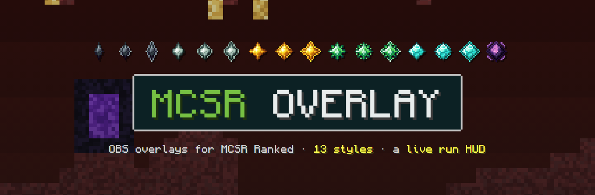
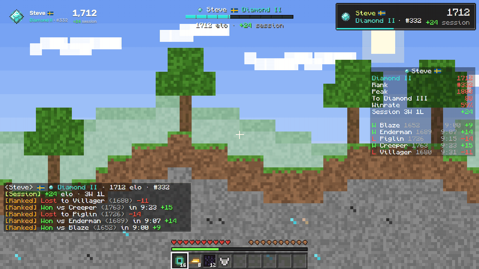
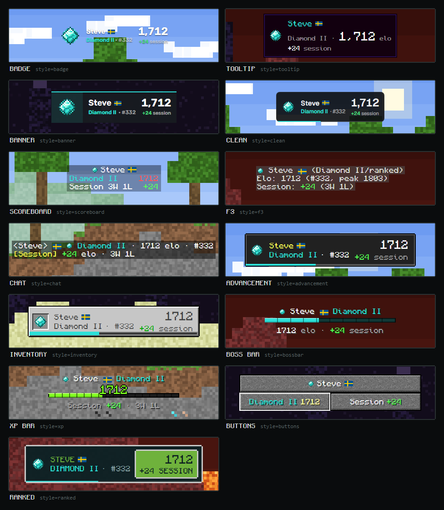
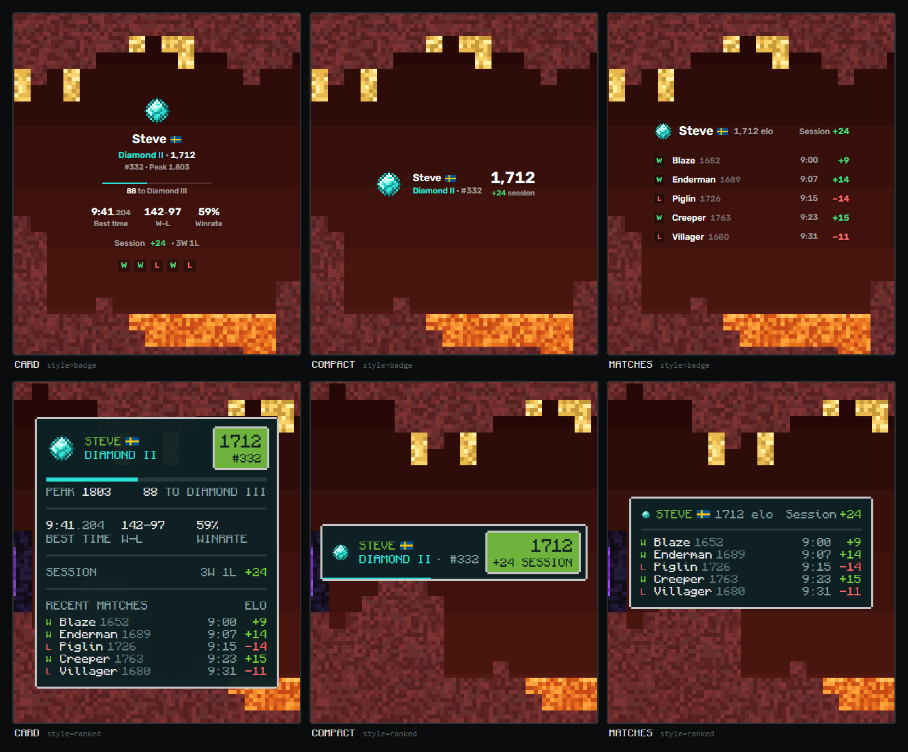
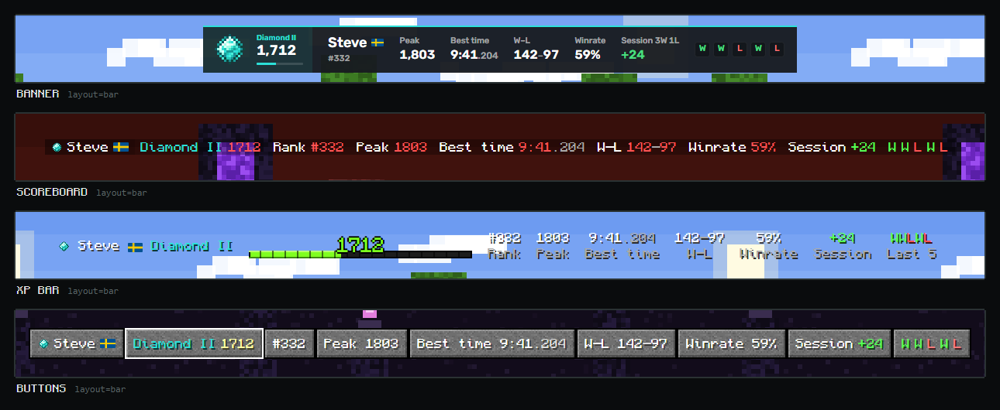
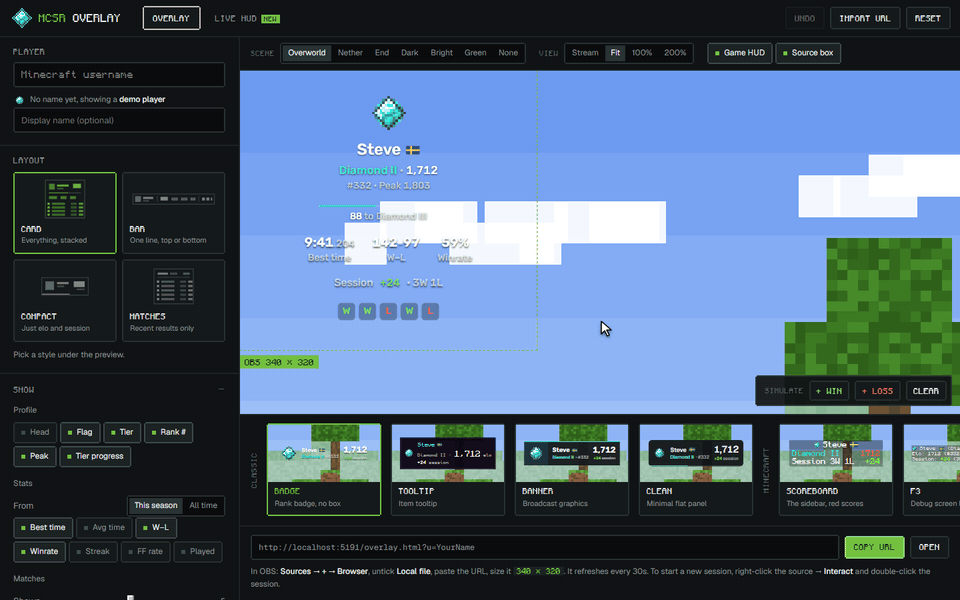
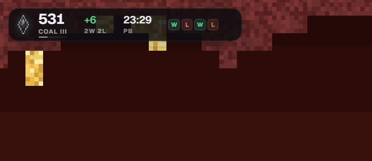
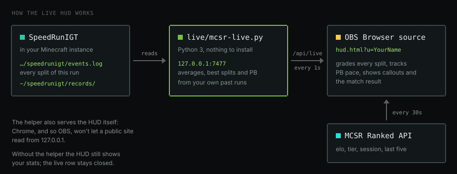

<p align="center"></p>

<p align="center">
  <a href="https://orqz.github.io/mcsr-overlay/"><b>Open the customizer</b></a> &nbsp;·&nbsp;
  <a href="https://orqz.github.io/mcsr-overlay/overlay.html?demo=1&style=scoreboard">Try a demo</a> &nbsp;·&nbsp;
  <a href="#styles">Styles</a> &nbsp;·&nbsp;
  <a href="#live-hud">Live HUD</a> &nbsp;·&nbsp;
  <a href="#obs-setup">OBS setup</a>
</p>

Stream overlays for [MCSR Ranked](https://mcsrranked.com): your rank badge, elo, tier progress, session, PB and recent matches, for any player, in 13 styles. Set it up in the customizer, copy one URL into OBS. Nothing to install.

<p align="center"></p>

<p align="center"><sub>Five overlays at once, laid out where Minecraft puts its own HUD. Win a match and they all update: popups, elo counting up, session and history.</sub></p>

## Styles

Thirteen styles, and every one works in all four layouts. Four are broadcast graphics; the other nine are built from Minecraft's own screens, in Minecraft's colors, font and text shadow.

<p align="center"></p>

| Style | Looks like |
| --- | --- |
| `badge` (default) | The rank badge up front, no box, text shadow so it reads over gameplay |
| `tooltip` | A Minecraft item tooltip |
| `banner` | Broadcast graphics with tier-colored rules |
| `clean` | A minimal flat panel |
| `scoreboard` | The sidebar: your name on top, red scores down the right |
| `f3` | The debug screen, a gray box behind every line. It lines up on the right when the overlay does |
| `chat` | Chat messages, newest at the bottom: `[Ranked] Won vs … in 9:23 +15` |
| `advancement` | The advancement toast. Netherite gets the purple challenge title |
| `inventory` | The light gray container GUI, your badge in a slot and stats in sunken slots |
| `bossbar` | Your name over a notched boss bar that fills with tier progress |
| `xp` | Your elo as the green XP level over the experience bar |
| `buttons` | The game menu: a stone button per line, the elo one hovered, tier progress as a slider |
| `ranked` | After MCSR Ranked's logo: a dark panel in a light pixel frame, green name, green elo box |

## Layouts

`card` has everything, `compact` is just elo and session, `matches` is your recent results, and `bar` puts it all on one line for the top or bottom of the screen.

<p align="center"></p>
<p align="center"></p>

## The customizer

<p align="center"></p>

[orqz.github.io/mcsr-overlay](https://orqz.github.io/mcsr-overlay/) builds the URL for you, and shows the overlay the way your stream will:

- **On a game scene.** The preview is a full 1920×1080 frame of the overworld, the nether or the end, with a hotbar, so you see the overlay at its real size next to the game's own HUD. Or use a flat, chroma green or transparent background. Zoom to the whole stream, to fit the overlay, 100% or 200%; the dashed box is exactly what your OBS source covers.
- **Styles you can see.** The style picker is the real overlay in every style, showing your own profile.
- **Simulate a match.** **+ Win** and **+ Loss** play the popup, count the elo up or down and add the result to your session and history, without waiting for a real game.
- **Pick up where you left off.** **Import URL** takes the URL already in your OBS source and loads it back in. So does opening `index.html?u=…&style=…`.
- **Undo** with Ctrl+Z, redo with Ctrl+Shift+Z.
- **Live HUD** has its own tab, with the demo run playing and the helper's setup steps.

Leave the username empty and it shows a demo player.

## Live HUD

<p align="center"></p>

`hud.html` is one small pill: rank badge, elo, tier progress, session elo, PB and your last five results. While you're in a run, a second row opens under it and reacts to every split, comparing it with your own past runs:

- **Each split** (nether, bastion, fortress, blind, stronghold, end, finish) gets a verdict: best ever, great, good, okay or slow pace, plus how far ahead of or behind your average you are.
- **The track** has a dot per split, and the gap to the next dot fills toward your average time for it. It turns orange once you're past that average.
- **PB pace:** while you're ahead of your PB run's splits, a gold light runs around the edge and the PB slot shows how far ahead you are. It switches off as soon as the clock passes your PB run's next split.
- **Callouts** under the pill: the opponent when a match starts, each split, a new PB, then the match result with your elo counting up.

<p align="center"></p>

The live part needs a small helper that reads the files [SpeedRunIGT](https://github.com/RedLime/SpeedRunIGT) writes: the current world's `events.log`, and `~/speedrunigt/records/` for your averages, best splits and PB. Ranked worlds are compared with ranked worlds, RSG with RSG. The helper also serves the HUD, because Chrome (and so OBS) blocks a public site from reading `127.0.0.1`.

1. [Download this repo](https://github.com/orqz/mcsr-overlay/archive/refs/heads/main.zip) (or clone it) and start the helper from its folder. Python 3, nothing to install:

   ```bash
   python3 live/mcsr-live.py
   ```

   On Windows that's `py live\mcsr-live.py`. It prints `mcsr-live on http://127.0.0.1:7477/hud.html?u=<your name>`. On Linux, `live/mcsr-live.service` starts it on login.

2. In OBS, add a **Browser** source:

   ```
   http://127.0.0.1:7477/hud.html?u=YourName&scale=1.4
   ```

3. Size it to 640×260 and leave the source's transform at 100% so the text stays sharp. Use `scale` to resize it instead.

Other params: `bga` sets panel opacity (0–100, default 84), `live=0` shows stats only, and `demo` plays a fake run so you can see every animation (`demo=40` is faster). Without the helper, the HUD still shows your stats. `python3 live/mcsr-live.py --dump` prints what the helper sees right now.

## Options

All of these are in the customizer; each is also a URL param on `overlay.html`, e.g. `overlay.html?u=orq2&style=scoreboard&layout=matches`.

- **Style and layout:** `style` (any of the 13 above), `layout` (`card`, `bar`, `compact`, `matches`)
- **Show:** player head, flag, tier, leaderboard #, peak, tier progress, best/average time, W–L, winrate, streak, FF rate, matches played, opponent elo/heads, seed icons, time ago
- **Session:** session elo, session time, session streak, new-match popup, idle reset (`reset`, hours)
- **Progress:** rank goal (`goal=Diamond I`, or an elo number), rotating info line in compact (`rotate`, seconds)
- **Look:** display name (`label`), size and scale, width, align/anchor, font, color palettes (including Nether and End), background/text/muted/accent/border/win/loss colors, opacity, fill (solid/gradient), texture (grid/dots/noise), corners, border, shadows
- **Demo:** `demo` shows a made-up Diamond II player with mobs for opponents, no API calls, and plays a match every 14 seconds. `demo=1850` picks the elo. Handy for trying a style in OBS before you've played ranked.

## OBS setup

1. Open the [customizer](https://orqz.github.io/mcsr-overlay/) (or `index.html` locally), enter a username, pick a style and layout, click **Copy URL**.
2. In OBS: **Sources → + → Browser**, untick **Local file**, paste the URL.
3. Set the width and height to the size the customizer shows next to the URL.

Data comes from the public MCSR Ranked API and refreshes every 30s by default. To start a new session, right-click the source → **Interact** and double-click the session.

## Files

| File | What it is |
| --- | --- |
| `index.html` | The customizer |
| `overlay.html` | The overlay; every option is a URL param |
| `hud.html` | The live HUD |
| `live/mcsr-live.py` | The helper that feeds the HUD your runs and serves it on 127.0.0.1:7477 |
| `scene.js` | The pixel-art scenes behind the customizer's preview |
| `assets/` | The images in this README |

## Credits

Rank badges, seed/bastion icons, division thresholds and tier colors are MCSR Ranked's own. The Minecraft styles and the customizer use [Monocraft](https://github.com/IdreesInc/Monocraft) (OFL-1.1). Player heads from mc-heads.net. The preview scenes are drawn in code from flat colors, no game textures. Built with [Claude Code](https://claude.com/claude-code). Not affiliated with MCSR Ranked or Mojang.
